

<picture><source media="(prefers-color-scheme: dark)" srcset="assets/hero-dark.svg"></picture>

<picture><source media="(prefers-color-scheme: dark)" srcset="assets/social-l-dark.svg"></picture><a href="https://linktr.ee/djleamen"><picture><source media="(prefers-color-scheme: dark)" srcset="assets/social-1-dark.svg"></picture></a><a href="https://www.linkedin.com/in/djleamen/"><picture><source media="(prefers-color-scheme: dark)" srcset="assets/social-2-dark.svg"></picture></a><a href="https://www.instagram.com/dejjos"><picture><source media="(prefers-color-scheme: dark)" srcset="assets/social-3-dark.svg"></picture></a><a href="https://www.youtube.com/@DJLeamen"><picture><source media="(prefers-color-scheme: dark)" srcset="assets/social-4-dark.svg"></picture></a><a href="https://www.facebook.com/dee.leamen/"><picture><source media="(prefers-color-scheme: dark)" srcset="assets/social-5-dark.svg"></picture></a><picture><source media="(prefers-color-scheme: dark)" srcset="assets/social-r-dark.svg"></picture>

<picture><source media="(prefers-color-scheme: dark)" srcset="assets/about-dark.svg"></picture>

<picture><source media="(prefers-color-scheme: dark)" srcset="assets/stack-dark.svg"></picture>

<a href="https://github.com/djleamen/SUSTAIN"><picture><source media="(prefers-color-scheme: dark)" srcset="assets/project-sustain-dark.svg"></picture></a>&nbsp;<a href="https://github.com/djleamen/MapleClear"><picture><source media="(prefers-color-scheme: dark)" srcset="assets/project-mapleclear-dark.svg"></picture></a>

<a href="https://github.com/djleamen/mai-buddy"><picture><source media="(prefers-color-scheme: dark)" srcset="assets/project-mai-buddy-dark.svg"></picture></a>&nbsp;<a href="https://github.com/djleamen/search-ad-learning"><picture><source media="(prefers-color-scheme: dark)" srcset="assets/project-search-ad-learning-dark.svg"></picture></a>

<a href="https://github.com/djleamen/Scrozam"><picture><source media="(prefers-color-scheme: dark)" srcset="assets/project-scrozam-dark.svg"></picture></a>&nbsp;<a href="https://github.com/djleamen/modelcules"><picture><source media="(prefers-color-scheme: dark)" srcset="assets/project-modelcules-dark.svg"></picture></a>

<picture><source media="(prefers-color-scheme: dark)" srcset="assets/stats-dark.svg"></picture>

<picture><source media="(prefers-color-scheme: dark)" srcset="assets/streak-dark.svg"></picture>

<picture><source media="(prefers-color-scheme: dark)" srcset="assets/wave-dark.svg"></picture>

<a href="https://djleamen.ca"><picture><source media="(prefers-color-scheme: dark)" srcset="assets/button-1-dark.svg"></picture></a>&nbsp;&nbsp;<a href="https://github.com/djleamen?tab=repositories"><picture><source media="(prefers-color-scheme: dark)" srcset="assets/button-2-dark.svg"></picture></a>

<a href="https://metawka.github.io/expressive-profile/?from=djleamen"><picture><source media="(prefers-color-scheme: dark)" srcset="assets/credit-dark.svg"></picture></a>

